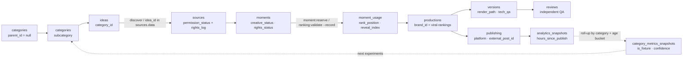

# Viral Rankings — architecture (real packages, DB, API)

2026-10-31, `pipeline-engineer`. Viral Rankings is a **brand inside the existing studio**, not a second studio: same SQLite file, event bus, job queue, task log, rights ledger, builder, QA and dashboard.

## 1. Packages

| Package | Role for viral-rankings | Status |
|---|---|---|
| `packages/shared` | `db.ts` (schema + additive `SCHEMA_V2`), `schemas.ts` (zod: `Category`, `CategoryMetricsSnapshot`, `Moment`, `MomentUsage`, `RankingPlan`), `events.ts` (task log + SSE source) | extended |
| `packages/ranking` (new) | `library.ts` categories / snapshots / moments / usage · `plan.ts` RankingPlan validator + rights gate · `reveal.ts` reveal-order director · `cutlist.ts` plan → cut list · `layout.ts` 9:16 geometry · `layers.ts` + `py/layers.py` overlay layers · `py/zone_check.py` burned-in text check | new |
| `packages/orchestrator` | CLI (`category:*`, `moment:*`, `ranking:*`, `brand:upsert --no-accounts`), queue, agent sync (`pipeline-engineer` actor) | extended |
| `packages/rights` | `setRights`, `assertPublishable` (source gate) — reused unchanged; moment-level rights go through `moment:set-status --rights`, logged in the same `rights_log` | reused |
| `packages/discovery` | Pexels/Pixabay/Wikimedia/IA/NASA search + acquire (rights-approved only) | reused; social adapters proposed |
| `packages/intelligence` | analyze / fullview / GPU transcription / techqa | reused |
| `packages/voice` | Gemini TTS (cached, shared quota) | reused |
| `packages/occ` | cut list → OpenChatCut project → headless render → master → techqa | extended (brand-gated rank layers, `fit_box`, caption x/size, import by content hash) |
| `apps/api` + `apps/studio/public` | Fastify API + vanilla JS dashboard + SSE | routes proposed (§5) |

## 2. Database (all in `data/studio.db`)

Existing tables used as-is: `brands`, `ideas`, `sources`, `rights_log`, `productions`, `versions`, `reviews`, `publishing`, `analytics_snapshots`, `events`, `agent_tasks`, `locks`, `jobs`.

New (CREATE IF NOT EXISTS, indexed):
- `categories` (id, brand_id, **parent_id** → two levels, slug UNIQUE per brand, title, purpose, audience_fit, research_queries, keywords, exclusions, origin, rights_risk, safety_constraints, review_cadence, next_experiments, status, timestamps)
- `category_metrics_snapshots` (append-only; category_id, observed_at, **age_bucket** 24h/72h/7d/28d/lifetime, platform, sample_size, 12 nullable metrics, confidence, **is_fixture**, source, provenance)
- `moments` (moment_id, source_id, brand/category/idea, start/end/setup/payoff/reaction ms, scene_boundaries, description, transcript, quality, rank_suitability, content_risks, tags, **creative_status**, **rights_status** (null = inherit source), license_conditions, checksum, phash, duplicate_of, audio_essential, baked_captions, evidence, reserved_by/until)
- `moment_usage` (production_id, version, moment_id, source_id, in/out ms, timeline_start_ms, rank_position, reveal_index, transformation, status planned→reserved→in_draft→approved→published|released, platform, published_at)

Altered: `ideas.category_id TEXT` (nullable; existing rows stay NULL). Idea proposals and judge scores use the existing `ideas.data` JSON: `data.scout` (scout id, round), `data.judge` ({scores, decision, why, chosen_format}). No new table needed until the arena UI needs filtering on them.

### Migration compatibility
- Additive only: no DROP, no rewrite, no NOT NULL on existing tables. Applied by `db()` on the next open (idempotent; `addColumn` checks `PRAGMA table_info`).
- Backup before migrating: `data/backups/studio-20261031-013208.db` (`VACUUM INTO`, consistent with WAL). `data/backups/` is git-ignored.
- Verified on the live DB: brands 4→5 (only `viral-rankings` added, 0 accounts), productions 222→222 (clipping 41, compilations 34, quiz-ar 128, rankings 19), approved 209→209, publishing 290→290 (scheduled/published 281→281), ideas 56→56.
- Tests run on a throwaway copy (`STUDIO_DB` env → temp file), never on the live DB: `scripts/test-viral-rankings.ts`.
- Rollback: the new tables are unused by older code; restoring the backup file returns the exact previous state.

## 3. Lineage

## 4. Flow for one ranking video
1. Category + idea (`category:add`, `idea:add` with `category_id`).
2. Sources discovered from clearable pools → `rights:set` proposals → rights-scout countersign.
3. Viral-analyst watches sources → `moment:add` (several per source) → `moment:set-status usable`.
4. Ranking director scores moments, `ranking:reveal` picks the reveal order, writes `plan.json` (RankingPlan), `ranking:validate` (must be publishable) → `moment:reserve` / `--record`.
5. `ranking:cutlist plan.json` → `cutlist.json` → `build <id>` (OCC; writes `moment_usage` in_draft) → techqa + `qa/zone_check.json` → qa-director + rights-scout → approve (policy bar 85, insights ≥85).

## 5. API routes the dashboard will need (not built yet)
All read-only GET unless noted; POSTs keep the `x-studio: 1` guard; paginate with `?limit&cursor`.
- `GET /api/vr/overview?brand=viral-rankings` — ideas in progress, usable moments, productions by stage, schedule, latest analytics.
- `GET /api/categories?brand=…&fixtures=0|1&age=24h|72h|7d` — tree + latest snapshot + `momentCounts` (available/used/rights pending/cleared/recently used/unused high-potential).
- `GET /api/categories/:id/snapshots` — history for charts (fixture rows labelled).
- `GET /api/moments?source=&category=&status=&rights=&available=&limit=&cursor=` and `GET /api/moments/:id` (with usage history + rights log + source URL).
- `GET /api/ranking/plans/:production` — plan.json + validation report; `POST /api/ranking/validate` (body = plan) → report; `POST /api/ranking/reveal` → director candidates.
- `GET /api/lineage/:production` — idea → sources → moments → usage → versions → reviews → publishing.
- `GET /api/ideas/arena?brand=` — proposals grouped by round with `data.judge`.
- SSE: existing `/api/stream` already carries `category.*`, `moment.*`, `ranking.usage`, `rights.changed` events.

## 6. Visual layers through OpenChatCut (build step, 2026-10-31)
**Mechanism (chosen):** the graphics are rendered by Pillow (`packages/ranking/py/layers.py`) as **full-canvas 1080x1920 RGBA PNGs** (title, one rail image per reveal state, brand mark) and **alpha WebM** (VP9 yuva420p; 0.5 s rank flash, 0.8 s CTA pill, alpha fades), imported into OpenChatCut and laid **1:1 with no transform** as image/video items on their own tracks - the same proven path as the quiz corner bug and alpha end-card (`packages/quiz/src/build.ts`). Picture, captions, narration and bed stay ordinary OCC items, so the project remains editable and **the final render is OCC's own headless export**. Why not OCC text items for the graphics: one colour per text item (no per-word colour spans), no per-card fill/outline/glow, and a 3-5 card rail would need ~15 text items per state. HyperFrames was not needed (no motion beyond fades); it remains the option for an animated rail.

| Layer | File(s) | OCC track | Timing |
|---|---|---|---|
| Two-colour title (Anton, ink outline 7.5 %, drop shadow, auto-fit 112→60 px, ≤ 3 balanced lines, y 270-585) | `vr_title.png` | VR Title | frame 0 → end |
| Rank rail (style v2 2026-11-04: cards x 28, y 540-950, 82 px pitch, files `vr_rail_<k>b/c/p.png` = base / active card / plate on tracks VR Rail / VR Rail Plate / VR Rail Card with slide-in x keyframes; v1: cards x 36, y 640-1130, right edge 290; active = yellow 254x150 + glow, revealed = ink card + label, hidden = dim `#N`; TOP 5 = smaller cards, pitch 98 px) | `vr_rail_<k>.png` (k = reveal index) | VR Rail | state k from reveal k to reveal k+1 (state 0 from frame 0) |
| Brand mark (`branding.logo_asset`, default `data/brand/viral-rankings/logo/watermark.png`, 300x80 at (40,150), 85 %; fallback text mark) | `vr_logo.png` | VR Brand | frame 0 → end |
| Rank flash `#N` 340 px (optional `rank_flash`) | `vr_flash_<rank>.webm` | VR Flash | 0.5 s at reveals 1..N-1 (never reveal 0: frame 0 = clean action + title) |
| Mid CTA pill (optional `cta_variant: mid_sub`) | `vr_cta.webm` | VR CTA | ≤ 0.8 s at `cta_at_ms`, else the first slot clear of payoffs (-0.6/+0.8 s), reveal starts and the first 1.5 s |
| Captions (existing builder captions, ink pill 80 %) | OCC text items | Captions | word-synced narration pages |

Footage: landscape = `fit_box [0,590,1080,1210]` (fit under the title band, blurred fill), portrait = cover. Caption band x 64-936, y 1215-1400 (`caption_x/y/font_px/max_chars`): title, rail and captions never overlap and stay inside the union safe box (x 64-936 / y 270-1420; rail and title reach x 36 / 1016 only at heights with no platform UI).
Track order: `Picture` (bottom, blur fill) < `Inserts` < `VR *` < `Overlays N` < `Captions`; when a VR track is missing on a rebuild, the text/audio tracks are recreated above it.
Collision check: `zone_check.py` maps the rail/caption/title zones back into each segment's source window (same fit/cover geometry, `layout.ts placedRect/zoneInSource`), samples 5 frames, and flags a zone when its strong-edge density is ≥ 0.09 and ≥ 1.6x the frame's own density in ≥ 2 samples (OCR-free heuristic for burned-in captions/logos; warn-only, `v<N>/qa/zone_check.json`, or `ranking:zones <production>`).
Known limits: portrait sources are full-bleed (rail over the picture's left edge); rail labels auto-shrink to 15-17 px and ellipsize beyond 3 lines; title is static (visible from frame 0, no per-word animation); the zone check cannot read text and can false-positive on dense textures (foliage, grilles) or miss low-contrast text.
